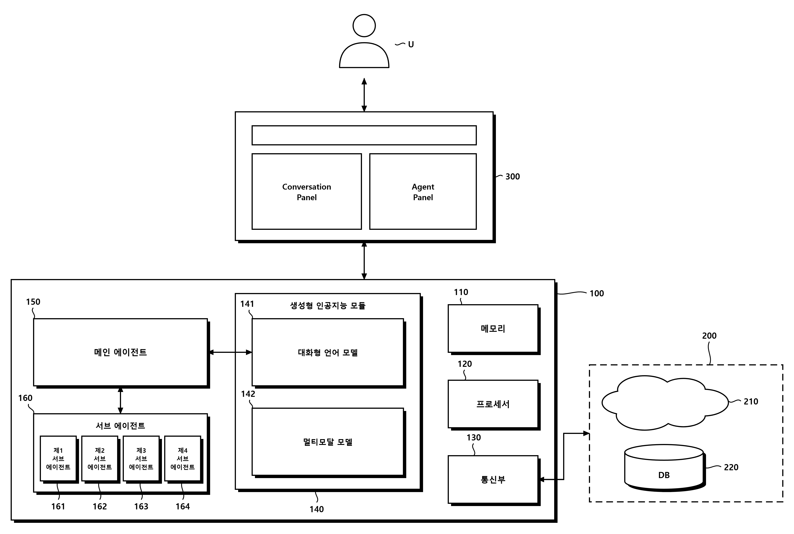

# KR_PATENT_SKILL

한국 특허 작성 실무를 돕는 24개 Agent Skills와 문서·도면 도구입니다. 발명자료 검토, 청구항·명세서 작성, 정합성 검토, DOCX 출력에 필요한 작업을 선택해 사용합니다.



## 시작하기

1. 저장소를 받습니다: `git clone https://github.com/lsj4232/KR_PATENT_SKILL.git`
2. 필요한 스킬 **폴더 전체**를 사용하는 에이전트의 스킬 경로에 설치합니다. `references/`, `scripts/`도 함께 필요합니다.
3. 자료와 원하는 결과를 지정합니다. 전체 과정은 `kr-patent-full-workflow`, 한 작업은 해당 스킬을 사용합니다.

Claude Code에서는 프로젝트의 `.claude/skills/<skill-name>/` 또는 개인 `~/.claude/skills/<skill-name>/`에 둘 수 있습니다. 실제 호출은 `/kr-patent-full-workflow`처럼 스킬 이름을 사용합니다. `/full`, `/recommend` 단축 명령은 이 저장소에서 등록하지 않습니다. [공식 설치·호출 안내](https://code.claude.com/docs/en/skills)

Claude의 스킬 업로드 기능을 이용할 때는 각 스킬 폴더와 참고자료를 함께 압축합니다. 전체 워크플로우에는 해당 단계의 다른 스킬도 설치되어 있어야 합니다. 도면 에디터는 별도 앱이므로 아래 안내에 따라 준비합니다.

예시 요청:

- “이 IDS로 청구항과 명세서 초안을 작성해줘. 불확실한 내용은 따로 표시해줘.”
- “이 문서는 검토만 해줘. 청구항·본문·도면의 불일치를 위치와 함께 알려줘.”
- “내용은 확정했어. 이 JSON을 DOCX로 만들어줘.”

## 스킬 선택

| 작업 | 스킬 |
|---|---|
| 미팅 질문 | [inventor-meeting](kr-patent-inventor-meeting/SKILL.md) |
| 현재 자료 진단·다음 작업 | [stage-recommender](kr-patent-stage-recommender/SKILL.md) |
| 독립항 | [claim1-drafting](kr-patent-claim1-drafting/SKILL.md) |
| 종속항·추가 독립항 | [dependent-claim-drafting](kr-patent-dependent-claim-drafting/SKILL.md) |
| 부호 체계 | [symbol-design](kr-patent-symbol-design/SKILL.md) |
| 도면 객체·부호 매핑 | [drawing-mapping](kr-patent-drawing-mapping/SKILL.md) |
| PNG 부호 삽입 | [drawing-tagging](kr-patent-drawing-tagging/SKILL.md) |
| 명세서 본문 | [spec-drafting](kr-patent-spec-drafting/SKILL.md) |
| 용어 정의 | [definition-insertion](kr-patent-definition-insertion/SKILL.md) |
| 구현 설명 보완 | [implementation-elaboration](kr-patent-implementation-elaboration/SKILL.md) |
| 변형 실시예 | [embodiment-addition](kr-patent-embodiment-addition/SKILL.md) |
| 전체 정합성 점검 | [consistency-check](kr-patent-consistency-check/SKILL.md) |
| 실시예 본문 집중 검토 | [detail-description-review](kr-patent-detail-description-review/SKILL.md) |
| 제한된 반복 정제 | [ralph-loop](kr-patent-ralph-loop/SKILL.md) |
| 선행기술 검색식 | [search-query](kr-patent-search-query/SKILL.md) |
| 선행기술 보고서 | [prior-art-report](kr-patent-prior-art-report/SKILL.md) |
| 새 블록도·흐름도 | [patent-block-diagram](patent-block-diagram/SKILL.md) |
| 기존 PBD 수정 | [patent-block-diagram-refine](patent-block-diagram-refine/SKILL.md) |
| DOCX 생성 | [docx-builder](kr-patent-docx-builder/SKILL.md) |
| 기존 DOCX 서식 | [format-unify](kr-patent-format-unify/SKILL.md) |
| Word 탐색창 | [navigation-pane](kr-patent-navigation-pane/SKILL.md) |
| DOCX → HLZ | [docx-to-hlz](docx-to-hlz/SKILL.md) |
| 여러 단계 이어서 수행 | [full-workflow](kr-patent-full-workflow/SKILL.md) |
| 요청에 따른 스킬 개선 | [skill-updater](kr-patent-skill-updater/SKILL.md) |

전체 흐름은 자료 확인 → 청구항 → 도면·부호 → 본문 → 필요한 보완 → 검토·수정 → 출력입니다. 기존 산출물을 이어 쓰고 불필요한 단계는 생략합니다. 645자·600문장 등 과거 고정 분량은 기본 요구에서 제외했습니다. 특정 문체와 ITER 10 템플릿은 요청한 경우에 선택합니다.

## 도구와 의존성

문서 지침만 사용하는 작업에는 아래 실행 환경이 모두 필요하지 않습니다.

| 기능 | 실행 환경 |
|---|---|
| DOCX 빌더 | Node.js, `kr-patent-docx-builder/package-lock.json`에 고정된 의존성 (`npm ci`) |
| 서식·탐색창 후처리 | Python, `python-docx` |
| PNG 부호 태깅 | Python, `opencv-python`, `numpy`, `Pillow` 및 사용 폰트 |
| DOCX → HLZ | Python, `python-docx`, `Pillow` |
| HWPX 보고서 | Python; 페이지 측정은 Windows·한글 COM·`pywin32` 필요 |
| 스킬 업데이터 | Python 표준 라이브러리 |
| 블록도 에디터 | Node.js·Electron, 앱의 잠금 파일에 따른 설치 |

DOCX 예시:

```bash
cd kr-patent-docx-builder
npm ci
node scripts/build_kr_patent.js --content /path/to/content.json --output /path/to/draft.docx
```

[입력 스키마](kr-patent-docx-builder/references/content-schema.md)를 사용합니다. 현재 빌더의 `figures`는 도면 제목·캡션만 출력하며 이미지 파일을 삽입하지 않습니다. 기존 Word 편집을 보존해야 하는 경우 재빌드하지 말고 해당 문서를 편집합니다.

## 특허 블록도 에디터

[patent-block-diagram-app](patent-block-diagram-app/README.md)은 PBD 원본을 편집하고 PNG로 내보내는 Electron 앱입니다. 실행·렌더링 상세는 앱과 도면 스킬 안내를 따릅니다.

```bash
cd patent-block-diagram-app
npm ci
npm start
```

에이전트용 인스턴스는 사용자 작업 창과 별도의 `--user-data-dir`를 사용합니다. CDP 연결·렌더링이 필요한 경우에만 실행합니다.

## 검증·유지보수

```bash
python -m pip install -r requirements-dev.txt
python scripts/validate_skills.py
python -m unittest discover -s tests -v
```

[기여 안내](CONTRIBUTING.md), [정리 기준과 공식 참고자료](docs/skill-maintenance.md), [행동 평가 사례](evals/skill-cases.json)를 참고하세요. 구조 검사와 스크립트 테스트는 모델의 실무 판단 성능 검증과 구분합니다.

이 도구는 업무 보조용입니다. 개별 출원의 법적 요건은 적용 시점의 공식 기준과 자료로 검토해야 하며, 점검 통과가 등록·출원 적합성을 보증하지 않습니다. 비공개 발명자료를 공개 예시나 스킬에 포함하지 마세요.

## English summary

24 composable skills for Korean patent drafting, review, document output, and diagrams. Install only the skills needed for your task. Instructions distinguish technical evidence from optional writing conventions; references load on demand. See each skill for inputs, tooling, and limits.

MIT License — see [LICENSE](LICENSE).
